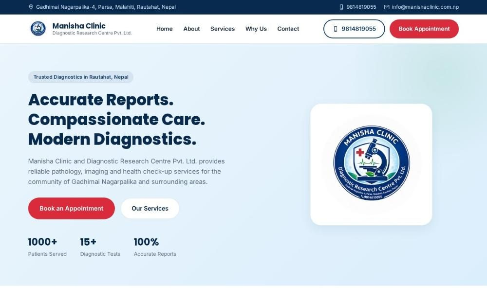

# Manisha Clinic & Diagnostic Research Centre

**Website for a diagnostic clinic in Parsa, Nepal.** A fast, mobile-friendly site that presents the clinic's pathology, imaging and diagnostic services and makes it easy for patients to book or get in touch.

**Live demo:** [titleshot.github.io/manisha-clinic-demo](https://titleshot.github.io/manisha-clinic-demo/)

## Sections

- Hero: "Accurate Reports. Compassionate Care. Modern Diagnostics." with booking and services buttons
- About the clinic and its commitment to patients
- Diagnostic services
- What makes the clinic different
- Visit or contact: address, phone and opening details

## Tech stack

Plain HTML, CSS and JavaScript (`index.html`, `css/`, `js/`, `assets/`). No framework and no build step, so it loads quickly and is hosted free on GitHub Pages.

## Run locally

Open `index.html` in a browser.

---

Built by **Ajit Thapa Magar**, web developer and product manager in Kathmandu. Portfolio: [ajit-portfolio-six.vercel.app](https://ajit-portfolio-six.vercel.app)
